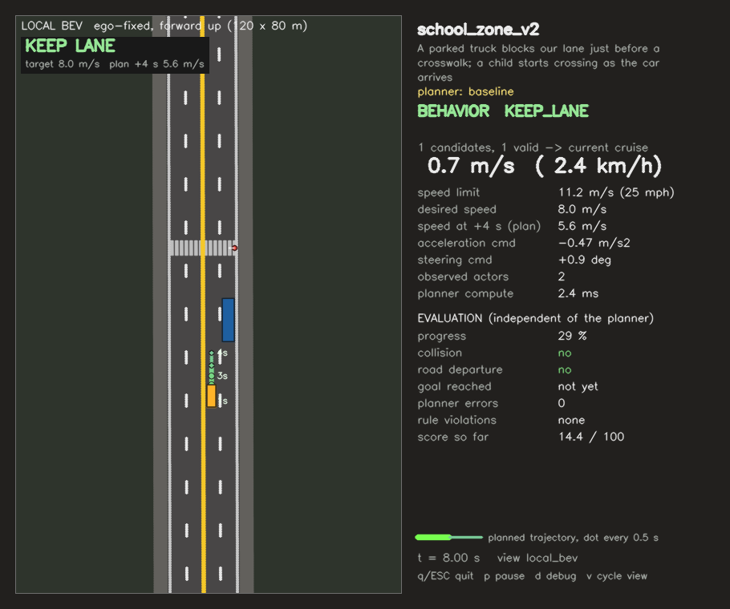

# Build a Self-Driving Car Project with Claude Code

**You do not need to be good at programming to start this tutorial.** You need to be good at something you already practise in engineering: saying clearly what you want, testing the result, and fixing what is wrong.

By the end you will have:

1. installed Claude Code on your own Windows or Mac computer;
2. used it to understand and run a real driving simulator;
3. built your own driving scene from a plain-English description, and fixed it when it was wrong;
4. trained a neural network to drive, without knowing machine learning beforehand.

---

## 1. What is Claude Code?

You may have used a chatbot that gives you code to copy. **Claude Code is different. It works inside your project folder.** It can:

* read every file in the folder;
* write and edit code;
* run programs and read the results or error messages;
* fix its own mistakes and try again.

**The best way to think about it:** Claude is a very fast junior engineer, and you are the engineer in charge. It does the typing. You decide what is needed and whether the result is right.

```
   YOU: "here is what I want"
              |
              v
   CLAUDE: reads files -> writes code -> runs it -> reads the result
              |
              v
   YOU: run it, watch it, check it  --->  right? done
              ^                               |
              |                            wrong?
              +--- "here is what I saw" <-----+
```

That loop is the whole skill. The rest of this tutorial is practice.

---

## 2. What you need

| Item | Details |
|---|---|
| **Computer** | Windows 10 (version 1809 or newer) or Windows 11, or macOS 13 or newer. At least 4 GB of RAM (8 GB or more is more comfortable for training). |
| **Internet** | Needed all the time, because Claude runs online. |
| **Claude account** | **The free Claude plan does not include Claude Code.** You need a paid plan or a Console account. **Your instructor will tell you which one to use for this course.** |
| **The project folder** | `AutonomousDrivingChallenge`, from your instructor. Unzip it somewhere easy to find, such as your Desktop. |

---

## 3. Install everything

A **terminal** is a window where you type commands instead of clicking. You only need a few commands, and Claude will handle most of them after this section.

### Step 1: Open a terminal

| Windows | Mac |
|---|---|
| Press `Win + X`, then choose **Terminal** or **Windows PowerShell**. | Press `Cmd + Space`, type `Terminal`, press `Enter`. |
| Your line should start with `PS C:\`. If there is no `PS`, you are in the wrong program (CMD). | |

### Step 2: Install Python

Go to [python.org/downloads](https://www.python.org/downloads/) and install **Python 3.10, 3.11 or 3.12**.

* **Windows:** on the first installer screen, **tick "Add python.exe to PATH"**. This is the step most people miss.
* **Mac:** run the installer and accept the defaults.

**Close the terminal, open a new one**, then check that it worked:

| Windows | Mac |
|---|---|
| `python --version` | `python3 --version` |

You should see something like `Python 3.12.4`.

### Step 3: Install Claude Code

Copy the line for your computer, paste it in the terminal, and press `Enter`.

**Windows (PowerShell):**

```powershell
irm https://claude.ai/install.ps1 | iex
```

**Mac:**

```bash
curl -fsSL https://claude.ai/install.sh | bash
```

It shows no progress while downloading, so **wait for it to finish**. Then **close the terminal, open a new one**, and check:

```bash
claude --version
```

A version number means it worked.

**Optional on Windows:** install [Git for Windows](https://git-scm.com/downloads/win), clicking Next on every screen. Claude works without it, using PowerShell, but Git gives it a few more tools.

### If something goes wrong

| What you see | What to do |
|---|---|
| `'irm' is not recognized` | You are in CMD. Open PowerShell (`Win + X`). |
| `'claude' is not recognized` (Windows) | Close and reopen the terminal. If it continues, run the two commands below this table, then open a new terminal. |
| `command not found: claude` (Mac) | Run `echo 'export PATH="$HOME/.local/bin:$PATH"' >> ~/.zshrc`, then open a new terminal. |
| `python` is not recognized (Windows) | Run the Python installer again and tick "Add python.exe to PATH". |
| Anything else | See the [official install troubleshooting page](https://code.claude.com/docs/en/troubleshoot-install), or show your instructor. |

The two Windows commands:

```powershell
$currentPath = [Environment]::GetEnvironmentVariable('PATH', 'User')
[Environment]::SetEnvironmentVariable('PATH', "$currentPath;$env:USERPROFILE\.local\bin", 'User')
```

---

## 4. Start Claude Code in your project

**Always start Claude from inside the project folder.** That folder is what it works on.

**Getting there the easy way:**

| Windows | Mac |
|---|---|
| Open the folder in File Explorer, right-click on empty space, choose **Open in Terminal**. On Windows 10, hold `Shift` while right-clicking and choose **Open PowerShell window here**. | In Terminal, type `cd ` (with the space), drag the folder into the window, press `Enter`. |

Then start Claude:

```bash
claude
```

The first time:

1. Your browser opens. **Log in** with your Claude account.
2. If Claude asks whether you trust this folder, choose **yes**. It is your project.
3. You see a box where you can type. That is it. You are in.

### The controls you need

| Key or command | What it does |
|---|---|
| `Enter` | Send your message |
| `Esc` | **Stop Claude right now.** It's fine to use it whenever Claude goes the wrong way |
| `Esc` `Esc` (with an empty input box) or `/rewind` | **Undo:** go back to an earlier point and restore the files Claude edited |
| `Shift + Tab` | Change how much Claude asks permission (see below) |
| `Up arrow` | Bring back your earlier message |
| `/clear` | Start a fresh conversation (do this when you change to a new task) |
| `/help` | Show all commands |
| `/exit` | Leave Claude Code |

### Permission: who is in control?

Claude can run commands on your computer, so you control how much it may do by itself. It normally starts in **Auto** mode, where it works without asking and a background check reviews its actions.

**For your first session, press `Shift + Tab` once to switch from Auto to Manual.** Claude will then ask before it edits a file or runs a command. Read each request and answer it. Once you are comfortable, the other modes save a lot of clicking.

Claude Code is updated often, so your screen may look a little different. If it does, just ask Claude: `how do I change the permission mode?`

---

## 5. Your first five minutes

Type these one at a time. **You are writing English, not code.** Spelling mistakes are fine.

**Ask what this is:**

```text
What does this project do? Explain it to me like I am a sophomore in
mechanical engineering who has only taken a basic programming course.
```

**Let Claude set up the project:**

```text
Set up this project for me on my computer: create a virtual environment and
install the requirements. Then run the self-test in tests/ to prove it works.
Do not change any code. Tell me in plain words what you did.
```

It should end with `19/19 tests passed`. The test takes a few minutes. A virtual environment is just a private box of Python packages for this project, and you don't need to know more than that right now.

**Connect it to what you know:**

```text
Find the vehicle model in this project. Show me the equations it uses and
explain each one using what a mechanical engineer learns in dynamics.
```

**See the simulator:**

```text
Give me the exact command to copy into a second terminal window, to run the
visual simulator with the lane_change_overtake scene and the baseline planner.
I am on [Windows / Mac].
```

Open a **second terminal** in the project folder and paste the command. The simulator window stays open until you press a key, so a second terminal keeps it out of Claude's way. Press `q` to quit, `p` to pause.



*What you are looking at: your car is orange, other vehicles are blue, the pedestrian is the red dot, and the green line is the planned trajectory. On the right are the speed, the planner's decision, and the live score.*

**Now see how powerful this is:**

```text
Run the lane_change_overtake scene without a window using the baseline
planner. Record the car's speed and its sideways position every step, then
make a plot of both against time and save it as a PNG. Explain the plot.
```

You just asked for a data-analysis tool and got it, with no programming from you. You could ask the same for your lab data next week.

---

## 6. How to write a good prompt

Claude can't read your mind. A good prompt has four parts, and you can remember them as **GOAL, DETAILS, RULES, CHECK**:

| Part | Question it answers | Example |
|---|---|---|
| **GOAL** | What do I want? | "Make a new driving scene." |
| **DETAILS** | What exactly does it look like? | "A truck parked in my lane, 75 m ahead." |
| **RULES** | What must it not do? | "Do not change the `simulator/` folder." |
| **CHECK** | How do we know it worked? | "Run it and show me the score." |

**CHECK is the part beginners forget, and it matters most.** When you ask Claude to test its own work, it finds and fixes many mistakes before you ever see them.

| Weak prompt | Why it is weak | Better prompt |
|---|---|---|
| "make a hard scene" | Hard how? | "Make a scene where a bicycle rides along the lane edge while a car comes the other way, so overtaking is only possible in a short gap. Run it with the baseline and show me the score." |
| "it doesn't work" | Claude didn't see what you saw | "When I run it, the truck drives through the car. I expected it to stop behind the car. Here is the output: ..." |
| "make it better" | Better at what? | "The car loses points for time. Find out where it wastes the most time, and suggest three fixes. Do not change anything yet." |

**Three more habits:**

* **Ask for a plan first on big jobs.** "Tell me your plan in five lines, and wait for my OK."
* **Say what you know.** "I don't know what a neural network is" gets you a much better answer. Nobody is judging you.
* **Ask why.** After any change: "Explain what you changed and why, as if I had to present it in class." If you can't explain it, you don't own it yet.

### Make Claude remember the rules

Type this once in a project:

```text
/init
```

Claude writes a file called `CLAUDE.md`, its notes about this project, and reads it at the start of every session. Then add your rules:

```text
Add these rules to CLAUDE.md: never change anything in simulator/,
scenarios/example_scenarios.py, evaluate.py or run_simulation.py. Follow
COMPETITION_RULES.md. I am a beginner, so explain your work in plain words.
```

---

## 7. Part A: Make a driving scene

Your job in the Scenario Team is to build scenes that are hard but fair. You will use a real example below: **a truck parked before a crosswalk, with a child crossing.**

### Step 1: Describe the scene

Don't start with the code. Start with what a driver would see:

```text
Read SCENARIO_GUIDE.md and COMPETITION_RULES.md first.

GOAL: Add a new scene called school_zone to scenarios/student_scenario.py.

DETAILS:
- A straight road with a crosswalk. My car starts about 90 m before the
  crosswalk at 8 m/s.
- A truck is parked in my lane, just before the crosswalk, so I have to go
  around it.
- A child crosses at the crosswalk, walking from the right sidewalk to the left.

RULES: Only change scenarios/student_scenario.py. The scene must be fair: a
careful driver must be able to get through it safely.

CHECK: Run it without a window using the baseline planner and show me the
result. Then give me the command to watch it myself in a second terminal.
```

Claude reads the guide, writes the code, runs it, and reports back. You will get something like this. You don't need to memorise it, and yours will be a bit different:

```python
def school_zone() -> Scenario:
    child = pedestrian(1, s_m=150.0, offset_m=8.95, walk_toward="left", speed_mps=1.3)
    parked = truck(2, s_m=110.0, offset_m=RIGHT_LANE, speed_mps=0.0)
    return Scenario(
        name="school_zone",
        description="Parked truck, then a child crossing at the crosswalk",
        road=crosswalk_road(), route=("crosswalk_road:F2",),
        ego_start_s_m=60.0, ego_speed_mps=8.0, desired_speed_mps=8.0, speed_limit_mps=25 * MPH,
        goal_distance_m=200.0, time_limit_s=45.0,
        actors=(child, parked))
```

### Step 2: Run it and look at it

**This step is yours. Don't skip it.** Run the command and watch. Press `p` to pause. Ask yourself:

* Did what I asked for actually happen?
* Does it look realistic?
* Is the score what I would expect?

### Step 3: Spot the mistake

This next result is real. We ran the scene above and got:

```
goal reached : True      progress : 100 %      collision : False
SCORE        : 99.4 / 100
```

**No error, a nearly perfect score, and the scene is still wrong.** Watching it, the child starts walking at time zero, so the car never gets near them. The closest it comes is 9.8 m, at full speed. The child is in the scene but makes no difference, and this scene tests nothing about crosswalks.

*Only a person who knows what the scene is for would catch this.* That person is you.

### Step 4: Re-prompt with what you saw

A good fix request has the same pattern every time: **I SAW, I EXPECTED, CHANGE, CHECK.**

```text
I SAW: The score is 99.4 and the car never slows down for the child. The child
starts walking at time 0, so the car passes when they are still far away.

I EXPECTED: The car should have to slow down and wait for the child.

CHANGE: Make the child wait on the sidewalk, then start crossing when the car
is coming past the truck. Move the truck close to the crosswalk, so the car
has little room to react. Keep it fair by the numbers in SCENARIO_GUIDE.md.

CHECK: Run it with the baseline. Report the car's lowest speed and its closest
distance to the child, so that we can see that it reacted.
```

When we made that change, the result was:

| | First version | After the re-prompt |
|---|---|---|
| When the child starts walking | 0 s | 6 s |
| Where the truck is parked | 110 m | 135 m |
| Car's speed near the crosswalk | about 8 m/s, no reaction | **slows to under 1 m/s**, waits, then drives on |
| Score (baseline planner) | 99.4 | 96.8 |

The score went **down** and the scene got **better**, because now the car has to do something. The picture in Section 5 is this scene at t = 8 s: the car has moved out around the truck and slowed down for the child.

**Bonus test:** the simple `student` planner scores only 16.0 on this scene. It stops behind the parked truck and waits until time runs out. You have made a scene that tells a good planner from a simple one, and that is the Scenario Team's job.

### What to do for each kind of mistake

| What happened | What to send Claude |
|---|---|
| **A red error message** | Paste the whole message. Add: "Fix this, and explain what caused it." |
| **It runs, but looks wrong** | "I SAW... I EXPECTED..." as above. Include the time when it happens, such as "at about 8 s". |
| **It's hard to describe** | "Run it with `--save-frames frames/`, look at the pictures around 8 s, and tell me where the child and the car are." Claude can look at images. |
| **The car crashes** | "The baseline crashes at 9 s. Would a careful human driver also crash? Use the numbers in SCENARIO_GUIDE.md. If so, make the scene fair. If not, explain what makes it hard." |
| **Too easy** | "The baseline scored 99. Make it harder using one idea from the table in SCENARIO_GUIDE.md section 6. Keep it fair." |
| **Claude made it worse** | Press `Esc` `Esc` and go back. Or say "Undo your last change." |
| **Claude changed something it shouldn't** | "You changed `simulator/`. That is against the rules. Undo it and solve this only in my scenario file." |

Real error messages from this project look like these. Claude can read them, so **you only have to paste them**:

```
ValueError: scenario bad: desired_speed_mps (15.00) is above speed_limit_mps (11.18)
```

```
KeyError: "unknown lane 'two_lane_road:F2'. Known lanes: ['crosswalk_road:F1', ...]"
```

### Your turn

Make these with Claude, in order:

1. **Easy:** a car ahead brakes hard, stops for 5 s, then drives on.
2. **Medium:** a slow truck ahead, and a fast car coming up in the left lane, so you have to wait for a gap.
3. **Your own:** think of a scary moment you have seen on a real road, then describe it to Claude.

---

## 8. Part B: Train a planner, knowing nothing about machine learning

### The idea, in plain words

The folder already includes a good driver: the **baseline** planner, written with rules. The training works like an apprentice learning to drive:

1. **Watch.** The expert drives through hundreds of random scenes. At every moment we record **what it saw** (141 numbers) and **what it planned** (16 numbers).
2. **Practise.** A neural network adjusts itself until, given what the expert saw, it predicts what the expert planned.
3. **Test.** The network drives by itself, and the simulator scores it.

As a mechanical engineer, you have done something similar. **Training is curve fitting.** You've fitted a trendline through lab data by adjusting two coefficients. Here the network fits a "curve" from 141 inputs to 16 outputs by adjusting 106,256 coefficients.

| Word you will hear | What it means |
|---|---|
| **Neural network / model** | The very flexible curve being fitted |
| **Weights** | The fitted coefficients. They are saved in a file such as `model.pt` |
| **Dataset** | The recorded table of "what it saw, what it planned" |
| **Training** | The computer adjusting the weights to reduce the error |
| **Loss** | The fitting error. Lower is a better fit |
| **Epoch** | One pass through the whole dataset |
| **Imitation learning** | Learning by copying an expert, which is what we do here |

That's all you need to begin. If you want more, ask Claude: it will explain as much as you want, at your level.

### Step 1: Ask Claude to be your teacher

```text
I know nothing about machine learning. Read planners/learned_example/README.md
and LEARNING_GUIDE.md, then explain how this learned planner was trained. Use
a mechanical engineering analogy, no jargon, and keep it to one page.
```

### Step 2: Run the example that has already been trained

```text
Install what is needed to run the learned_example planner. Use the CPU-only
version of PyTorch. Then compare it with the baseline using evaluate.py, and
explain the score table to me. Do not change any code.
```

### Step 3: Train your own

Replace `my_team` with your team's name.

```text
I want to train my own neural-network planner called my_team. I am a beginner.

GOAL: Copy planners/learned_example to planners/my_team, register it in
planners/__init__.py, and train it on my computer using imitation learning.

DETAILS: Start small, with 40 random episodes of training data, so that we can
test everything quickly.

RULES:
- Do NOT overwrite planners/learned_example/weights/model.pt or
  training/data.npz. Make my own copies of the training scripts, which save my
  data and my weights in my own files.
- Do not change anything in simulator/.
- Before you start each long step, tell me how long you expect it to take.

CHECK: Run evaluate.py with baseline and my_team. Show me the score table,
and tell me in plain words what my planner does well and badly.
```

**How long it takes:** in our tests on 4 CPU cores, recording 40–120 episodes took about 10–20 minutes, and training took under a minute. No graphics card is needed. Leave the terminal open and do something else while it runs.

**That's it. You've trained a neural network that drives a car.** Now comes the important part.

### Step 4: Read the results honestly

These are real results from following these steps. The score is out of 100 per scene.

| Scene | Baseline (expert) | Trained on 40 episodes | Trained on 120 episodes | Example, trained on 400 episodes |
|---|---|---|---|---|
| `lead_vehicle_brakes` | 92.9 | 91.1 | 41.3 (too slow) | 44.1 (too slow) |
| `lane_change_overtake` | 98.2 | 98.5 | **0.0** (crash, hit from behind) | 37.8 (too slow) |
| `intersection_crossing_traffic` | 96.7 | 99.1 | 97.0 | 100.0 |
| `my_crosswalk` | 97.6 | **0.0** (hit the pedestrian) | 95.2 | 100.0 |
| **Total of these four** | **385.4** | **288.7** | **233.5** | **281.9** |
| Our `school_zone` scene | 96.8 | 16.1 (stuck) | 16.0 (stuck) | 13.4 (stuck) |

Look carefully, because there are surprises here:

* **Three times more data did not simply make it better.** It fixed the crosswalk but broke overtaking.
* **A network can match the expert on one scene and hit a pedestrian on another.** A high average would hide that.
* **All three networks got stuck behind our parked truck**, while the expert got through it.
* **Your numbers will be different.** Small changes in training can change the driving a lot.

**The lesson: never trust the training loss or Claude's summary alone. Judge a planner only by watching it drive and by `evaluate.py`.** In this project, a change once lowered the training loss and made the car crash at the intersection anyway.

### Step 5: Re-prompt to improve it

Give Claude your real results, and ask it to **find the cause before it changes anything**:

```text
Here is my score table: [paste it].

I SAW: my_team hit the pedestrian in my_crosswalk, at about 9 s.

FIRST, investigate only. Do not change anything yet. Run that scene, save
pictures around the crash, and find out what the network planned just before
it. Tell me your best explanation, how sure you are, and how we could test it.
```

Read the answer. If it makes sense:

```text
OK, try your fix. Change only one thing. Run evaluate.py on ALL scenes before
and after, not only on the scene that failed, and show me both tables. If the
total gets worse, tell me and undo the change.
```

**Why "all scenes"?** Because of the table above: fixing one scene can break another.

Other good requests:

| Your problem | What to ask |
|---|---|
| "It gets stuck behind parked vehicles" | "Do the training scenes contain vehicles parked in my lane? Check `random_scenario` in the training code. If not, add some, retrain, and compare the scores." |
| "It's too slow" | "Find out in which scene it drives slowest compared with the expert, and why. Suggest options, and tell me which is easiest." |
| "It crashes in new scenes" | "Explain what DAgger is in plain words. Would it help here? Add it, if it's a reasonable job, and compare the scores." |
| "I want to beat the baseline" | "Read section 8 of the learned_example README and the ideas at its end. Which single idea is most likely to help me? Make a plan, and wait for my OK." |
| "Training crashed" | Paste the error. "Fix this. Explain what happened." |

Problems like these happened while the included example was being built with Claude. For instance, the first network output a speed of **180,000 m/s** at its first traffic light. It was found the same way you'll find yours: by running it, noticing that something was wrong, and asking why.

---

## 9. How this project was built with Claude

Everything in this folder was produced by giving Claude instructions like the ones above, and then checking and correcting the results.

| What was built | How it was done |
|---|---|
| **Simulator** (about 2,700 lines) | Claude was told to make a clean, simple student version of an existing research simulator, keeping the same vehicle model, controller and display, and proved it by comparing screenshots. |
| **Baseline planner** | Claude simplified a large research planner (about 3,500 lines) down to about 620 lines. Each fix was made because a test run showed a specific failure. |
| **Scenes** | Described in plain English, run, watched, corrected, exactly as in Part A. |
| **Trained planner** | Claude wrote the data recording, the network and the training, then improved them after each failure, as in Part B. |
| **Tests and guides** | Claude wrote the 19 self-tests and the guides, including this one. |

**Being honest:** it didn't happen in one prompt, and it didn't start from nothing. It took many rounds of "run it, look at it, that's wrong, fix it", directed by an experienced researcher who knew what the result should look like. Your jobs are much smaller, so you can start today and build up that judgment as you go.

---

## 10. You can use this for anything

Now that you know the loop, try it on your other work. Start in a new, empty folder.

```text
I have a CSV file of tensile-test data in this folder. Find the Young's modulus
and yield strength, plot the stress-strain curve, and explain how you got them.
```

```text
Make a small program where I enter the loads on a simply supported beam, and it
draws the shear and bending-moment diagrams. Then test it on a textbook case
whose answer is known.
```

```text
Make a simple animation of a four-bar linkage, where I can change the link
lengths. I want to see when the mechanism locks up.
```

**Notice the last sentence in the beam prompt:** test it on a case whose answer you know. That's how an engineer uses a tool they did not build.

---

## 11. Using it responsibly

**Claude is powerful, and it makes mistakes.** It can write wrong code and sound confident. It can also say something works when it hasn't really checked. You are responsible for the result, the same way you are responsible for a calculation you did with software.

* **Test everything.** Run it yourself, and try a case where you know the answer.
* **Understand what you hand in.** Ask "explain this" until you could explain it to your instructor.
* **Follow your course's rules.** Check what your instructor and school allow, and say how you used AI when you're asked.
* **Keep a backup.** Before a big change, copy your project folder. `/rewind` undoes the file edits Claude makes itself, but not everything that commands do.
* **Read before you approve.** Be especially careful if Claude wants to delete files, or work outside your project folder.
* **Keep secrets out.** Don't paste passwords or private information into Claude.
* **Mind your usage limits.** Plans have limits. Use `/clear` when you switch tasks, and keep your requests focused.

---

## 12. Cheat sheet

**Start:**

```bash
cd path/to/AutonomousDrivingChallenge
claude
```

**Run the project yourself in a second terminal** (no need to activate anything):

| Windows | Mac |
|---|---|
| `venv\Scripts\python run_simulation.py --list` | `venv/bin/python run_simulation.py --list` |
| `venv\Scripts\python run_simulation.py --scenario school_zone` | `venv/bin/python run_simulation.py --scenario school_zone` |
| `venv\Scripts\python evaluate.py --planner baseline student` | `venv/bin/python evaluate.py --planner baseline student` |

These assume Claude named the virtual environment `venv`. If in doubt, ask it for the exact command.

**New request:** GOAL, DETAILS, RULES, CHECK.

**Fix request:** I SAW, I EXPECTED, CHANGE, CHECK.

**When lost, just ask:**

```text
I'm lost. Where are we, what did you just do, and what should I do next?
```

**Learn more:** [official quickstart](https://code.claude.com/docs/en/quickstart) · [guide for first-time terminal users](https://code.claude.com/docs/en/terminal-guide) · [free Claude Code 101 course](https://academy.claude.com/courses/claude-code-101)
