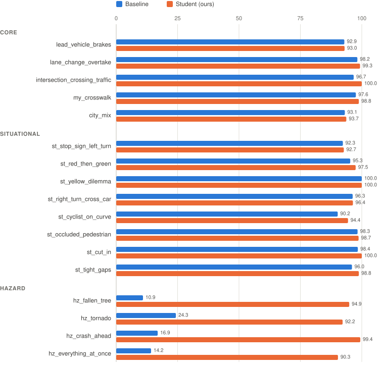

# Planner scores

Every scenario run once per planner in headless mode on 17 November 2026. Regenerate with `venv\Scripts\python.exe tools\run_all.py`.

The student planner averages **96.5 / 100** against the baseline's **77.2**. It scores higher on 16 of 17 scenarios, ties on 1 and loses on 0.

| Group | Scenarios | Baseline avg | Student avg |
|---|---:|---:|---:|
| Core + situational | 13 | 95.8 | 97.2 |
| Hazard | 4 | 16.6 | 94.2 |
| **All** | 17 | **77.2** | **96.5** |

Collisions, road departures or rule violations: none in any run.

| Scenario | Group | Baseline | Student | Gain | Baseline result | Student result | Student time (s) |
|---|---|---:|---:|---:|---|---|---:|
| `lead_vehicle_brakes` | Core | 92.9 | 93.0 | +0.1 | goal reached | goal reached | 38.4 |
| `lane_change_overtake` | Core | 98.2 | 99.3 | +1.1 | goal reached | goal reached | 41.5 |
| `intersection_crossing_traffic` | Core | 96.7 | 100.0 | +3.3 | goal reached | goal reached | 21.3 |
| `my_crosswalk` | Core | 97.6 | 98.8 | +1.2 | goal reached | goal reached | 26.6 |
| `city_mix` | Core | 93.1 | 93.7 | +0.6 | goal reached | goal reached | 49.8 |
| `st_stop_sign_left_turn` | Situational | 92.3 | 92.7 | +0.4 | goal reached | goal reached | 42.6 |
| `st_red_then_green` | Situational | 95.3 | 97.5 | +2.2 | goal reached | goal reached | 32.5 |
| `st_yellow_dilemma` | Situational | 100.0 | 100.0 | +0.0 | goal reached | goal reached | 22.9 |
| `st_right_turn_cross_car` | Situational | 96.3 | 96.4 | +0.1 | goal reached | goal reached | 33.6 |
| `st_cyclist_on_curve` | Situational | 90.2 | 94.4 | +4.2 | goal reached | goal reached | 41.8 |
| `st_occluded_pedestrian` | Situational | 98.3 | 98.7 | +0.4 | goal reached | goal reached | 26.7 |
| `st_cut_in` | Situational | 98.4 | 100.0 | +1.6 | goal reached | goal reached | 29.7 |
| `st_tight_gaps` | Situational | 96.0 | 98.8 | +2.8 | goal reached | goal reached | 30.4 |
| `hz_fallen_tree` | Hazard | 10.9 | 94.9 | +84.0 | time limit | goal reached | 33.5 |
| `hz_tornado` | Hazard | 24.3 | 92.2 | +67.9 | time limit | goal reached | 49.3 |
| `hz_crash_ahead` | Hazard | 16.9 | 99.4 | +82.5 | time limit | goal reached | 25.7 |
| `hz_everything_at_once` | Hazard | 14.2 | 90.3 | +76.1 | time limit | goal reached | 76.6 |
